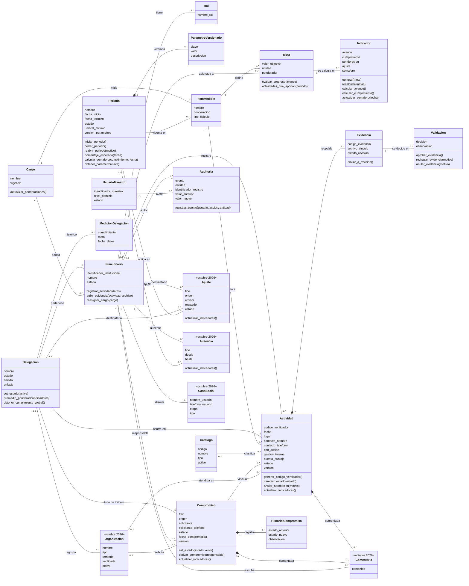

# Diagrama de clases del SGR

Sacado de los modelos reales (`delegaciones_app/models.py`) después de los cambios de la rama `feat/requerimientos-octubre`. Muestra los atributos principales, los métodos de negocio y las relaciones con su cardinalidad. Las clases marcadas como **nuevas** (en otro color y con el estereotipo `octubre 2026`) son las que agregaron los requerimientos de octubre: Organizacion, Ajuste, Ausencia, CasoSocial y Comentario.

Se omiten los campos técnicos (id, fechas de creación) y la clase `FuncionarioRol`, que es la tabla intermedia de la relación muchos a muchos entre Funcionario y Rol.

## Qué cambió en el diseño por los requerimientos de octubre

| Clase | Qué agrega | Regla de octubre |
| --- | --- | --- |
| Organizacion | Las organizaciones comunitarias con su tipo y delegación; la actividad y la tarea pueden indicar a cuál atendieron | Tipos de organización |
| Ajuste | Felicitaciones y reclamos con respaldo, informados por el delegado y aplicados por la coordinación | Regla 8 |
| Ausencia | Días que no se trabajaron, descontados de lo esperado al día | Regla 9 |
| CasoSocial | Atención social por etapas, hasta tres gestiones por usuario | Área social (RF-015) |
| Comentario | Observaciones sobre una actividad o una tarea | RF-035 |

También cambiaron clases existentes:

- **Actividad:** `tipo_accion` (gestión previa), `gestion_interna` y `cuenta_puntaje` con `motivo_sin_puntaje` (reglas 1, 2 y 5).
- **ItemMedible:** `tipo_calculo` («actividades» o «tubo»).
- **Compromiso:** `item`, `solicitante_telefono`, `organizacion` y `gestion_interna` (regla 1 e ítem del tubo).
- **Indicador:** `ajuste` y el método `recalcular`, que usan Ajuste, Ausencia y Compromiso para mantener el semáforo al día.
- **ParametroVersionado:** guarda las claves de las reglas: `maximo_cumplimiento`, `max_ingresos_diarios`, `valor_felicitacion`, `max_felicitaciones` y `valor_reclamo`.

La justificación de cada clase nueva está en [MODELO_DATOS.md](../MODELO_DATOS.md).
