# Modelo entidad-relación

Reemplaza a las figuras 33 a 35 del informe (entidad-relación, lógico y físico). Usa los nombres físicos de las tablas y las columnas de los modelos reales (`delegaciones_app/models.py`) después de la migración `0028`. Las cinco tablas nuevas de octubre 2026 son `delegaciones_app_organizacion`, `delegaciones_app_ajuste`, `delegaciones_app_ausencia`, `delegaciones_app_casosocial` y `delegaciones_app_comentario`. Se omiten las tablas internas de Django, salvo `auth_user`, a la que se conectan las cuentas.

```mermaid
erDiagram
    auth_user ||--o| funcionario : "cuenta"
    auth_user ||--o| usuario_maestro : "cuenta"
    delegacion |o--o{ funcionario : "pertenece"
    cargo ||--o{ funcionario : "ocupa"
    funcionario ||--o{ funcionario_rol : "tiene"
    rol ||--o{ funcionario_rol : "asignado"
    periodo ||--o{ parametro_versionado : "versiona"
    cargo ||--o{ item_medible : "mide"
    periodo ||--o{ item_medible : "vigente"
    item_medible ||--o{ meta : "define"
    funcionario ||--o{ meta : "asignada"
    meta ||--o{ indicador : "calcula"
    periodo ||--o{ indicador : "del periodo"
    funcionario ||--o{ actividad : "autor"
    delegacion ||--o{ actividad : "ocurre en"
    item_medible ||--o{ actividad : "aporta"
    catalogo |o--o{ actividad : "tipo de atencion"
    compromiso |o--o{ actividad : "vincula"
    actividad ||--o{ evidencia : "respalda"
    evidencia ||--o{ validacion : "decide"
    funcionario ||--o{ validacion : "verificador"
    delegacion ||--o{ compromiso : "tubo"
    funcionario ||--o{ compromiso : "responsable"
    item_medible |o--o{ compromiso : "item tubo"
    compromiso ||--o{ historial_compromiso : "registra"
    delegacion ||--o{ medicion_delegacion : "historico"
    funcionario |o--o{ auditoria : "autor"
    usuario_maestro |o--o{ auditoria : "autor"
    delegacion |o--o{ delegaciones_app_organizacion : "agrupa"
    delegaciones_app_organizacion |o--o{ actividad : "atendida"
    delegaciones_app_organizacion |o--o{ compromiso : "solicita"
    periodo ||--o{ delegaciones_app_ajuste : "aplica en"
    funcionario |o--o{ delegaciones_app_ajuste : "destinatario"
    delegacion |o--o{ delegaciones_app_ajuste : "destinataria"
    funcionario ||--o{ delegaciones_app_ausencia : "ausente"
    periodo ||--o{ delegaciones_app_ausencia : "descuenta en"
    funcionario ||--o{ delegaciones_app_casosocial : "atiende"
    actividad |o--o{ delegaciones_app_comentario : "comentada"
    compromiso |o--o{ delegaciones_app_comentario : "comentada"
    funcionario ||--o{ delegaciones_app_comentario : "autor"

    delegacion {
        bigint id PK
        varchar nombre UK
        boolean estado
        varchar ambito
        text enfasis
    }
    cargo {
        bigint id PK
        varchar nombre
        boolean vigencia
    }
    rol {
        bigint id PK
        varchar nombre_rol UK
    }
    funcionario {
        bigint id PK
        int usuario_id FK
        varchar identificador_institucional UK
        varchar nombre
        bigint cargo_id FK
        bigint delegacion_id FK "nullable"
        boolean estado
    }
    funcionario_rol {
        bigint id PK
        bigint funcionario_id FK
        bigint rol_id FK
    }
    usuario_maestro {
        bigint id PK
        int usuario_id FK "nullable"
        varchar identificador_maestro
        varchar nivel_dominio
        boolean estado
    }
    periodo {
        bigint id PK
        varchar nombre UK
        date fecha_inicio
        date fecha_termino
        varchar estado
        decimal umbral_minimo
        int version_parametros
    }
    parametro_versionado {
        bigint id PK
        bigint periodo_id FK
        varchar clave "unico con periodo"
        varchar valor
    }
    item_medible {
        bigint id PK
        bigint cargo_id FK
        bigint periodo_id FK
        varchar nombre
        decimal ponderacion
        varchar tipo_calculo "actividades o tubo"
    }
    catalogo {
        bigint id PK
        varchar codigo UK
        varchar nombre
        varchar tipo
        boolean activo
    }
    meta {
        bigint id PK
        bigint item_id FK
        bigint funcionario_id FK
        decimal valor_objetivo
        decimal ponderador
    }
    indicador {
        bigint id PK
        bigint meta_id FK
        bigint periodo_id FK
        datetime fecha_calculo
        decimal avance
        decimal cumplimiento
        decimal ponderacion
        decimal ajuste
        varchar semaforo
    }
    actividad {
        bigint id PK
        varchar codigo_verificador UK
        bigint funcionario_autor_id FK
        bigint delegacion_id FK
        bigint item_id FK
        bigint catalogo_id FK "nullable"
        bigint compromiso_id FK "nullable"
        bigint organizacion_id FK "nullable"
        datetime fecha
        varchar lugar
        varchar contacto_nombre
        varchar contacto_telefono
        varchar tipo_accion
        boolean gestion_interna
        boolean cuenta_puntaje
        varchar estado
        int version
    }
    evidencia {
        bigint id PK
        varchar codigo_evidencia UK
        bigint actividad_id FK
        varchar archivo_vinculo
        varchar estado_revision
    }
    validacion {
        bigint id PK
        bigint evidencia_id FK
        bigint funcionario_verificador_id FK
        varchar decision
        text observacion
    }
    compromiso {
        bigint id PK
        varchar folio UK
        bigint delegacion_id FK
        bigint funcionario_responsable_id FK
        bigint item_id FK "nullable"
        bigint organizacion_id FK "nullable"
        varchar solicitante
        varchar solicitante_telefono
        boolean gestion_interna
        date fecha_comprometida
        varchar estado
        int version
    }
    historial_compromiso {
        bigint id PK
        bigint compromiso_id FK
        varchar estado_anterior
        varchar estado_nuevo
        bigint autor_id FK
    }
    medicion_delegacion {
        bigint id PK
        bigint delegacion_id FK
        decimal cumplimiento
        date fecha_datos
    }
    auditoria {
        bigint id PK
        bigint funcionario_id FK "nullable"
        bigint usuario_maestro_id FK "nullable"
        varchar evento
        varchar entidad
        varchar identificador_registro
        text valor_anterior
        text valor_nuevo
    }
    delegaciones_app_organizacion {
        bigint id PK
        varchar nombre "unico con territorio"
        varchar tipo
        varchar territorio
        bigint delegacion_id FK "nullable"
        boolean verificada
        boolean activa
    }
    delegaciones_app_ajuste {
        bigint id PK
        varchar tipo "felicitacion o reclamo"
        varchar emisor
        bigint funcionario_id FK "nullable"
        bigint delegacion_id FK "nullable"
        bigint periodo_id FK
        varchar respaldo
        varchar estado
        bigint informado_por_id FK
        bigint aplicado_por_id FK "nullable"
    }
    delegaciones_app_ausencia {
        bigint id PK
        bigint funcionario_id FK
        bigint periodo_id FK
        varchar tipo
        date desde
        date hasta
        bigint registrada_por_id FK
    }
    delegaciones_app_casosocial {
        bigint id PK
        bigint funcionario_id FK
        varchar nombre_usuario
        varchar telefono_usuario
        smallint etapa "1 a 3"
        varchar tipo
    }
    delegaciones_app_comentario {
        bigint id PK
        bigint actividad_id FK "nullable"
        bigint compromiso_id FK "nullable"
        bigint autor_id FK
        text contenido
    }
```

Notas:

- `||--o{` es «uno a cero o muchos»; `|o--o{` es «cero o uno a cero o muchos» (llave foránea opcional).
- `delegaciones_app_ajuste` exige exactamente uno de `funcionario_id` o `delegacion_id`, y `delegaciones_app_comentario` exactamente uno de `actividad_id` o `compromiso_id`. Esas reglas se validan en el modelo (`clean`), no con una restricción de la base.
- Las cinco tablas nuevas conservan el nombre que Django les asigna por defecto (`delegaciones_app_…`), a diferencia de las 17 del diseño original, que fijan su nombre con `db_table`.
