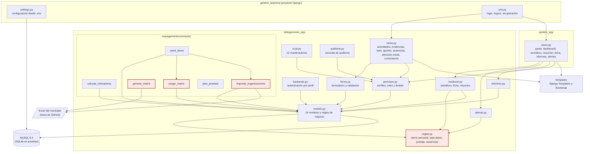

# Diagrama de paquetes

Reemplaza a la figura 37 del informe. Muestra los módulos reales del proyecto y sus dependencias. Los módulos nuevos o que cambiaron de responsabilidad por los requerimientos de octubre 2026 van en otro color: `reglas.py` (reglas 1 a 9 de octubre) y los comandos `importar_organizaciones`, `generar_matriz` y `cargar_matriz`.

Solo `models.py` (y los comandos, a través de los modelos) accede a la base de datos mediante el ORM. `reglas.py` concentra las reglas de octubre para que las usen por igual el modelo (al guardar), la medición (lo esperado al día) y las alertas.
