# Diagrama de requerimientos

Reemplaza a las figuras 1 a 12 del informe. Sigue el modelo «Relación entre los artefactos»: cada épica se expresa como
una gestión «Gestionar X» (la misma de los casos de uso de alto nivel) y de ella cuelgan sus requerimientos
(«Debe permitir…»). Los requerimientos de octubre 2026 (RF-039 a RF-050) van en otro color. Generado desde
`docs/casos_uso/fuente/datos_v2.py` y `CATALOGO_RF` (`delegaciones_app/plan_pruebas.py`).

## G02 Gestionar actividades

Épica EP-01: Registro y gestión de actividades.

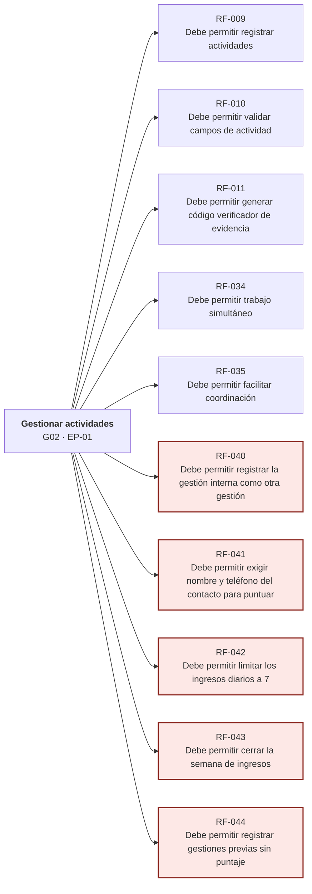

## G03 Gestionar evidencias

Épica EP-03: Evidencias y verificación.

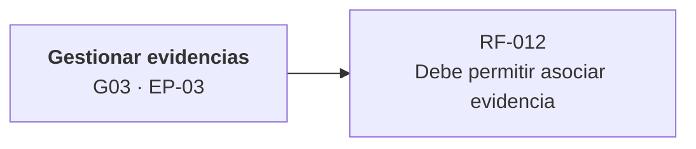

## G04 Validar actividades

Épica EP-03: Evidencias y verificación.

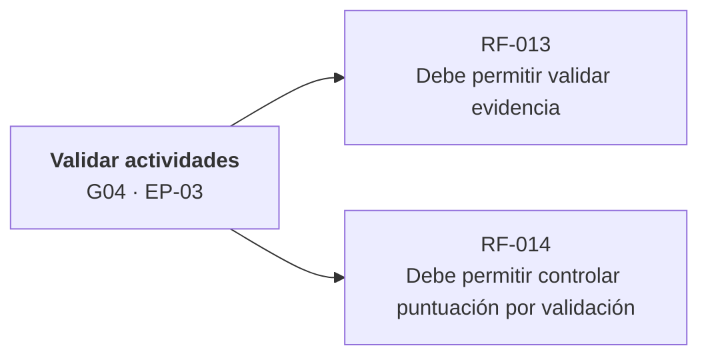

## G05 Gestionar tubo de trabajo

Épica EP-04: Agenda colectiva y compromisos.

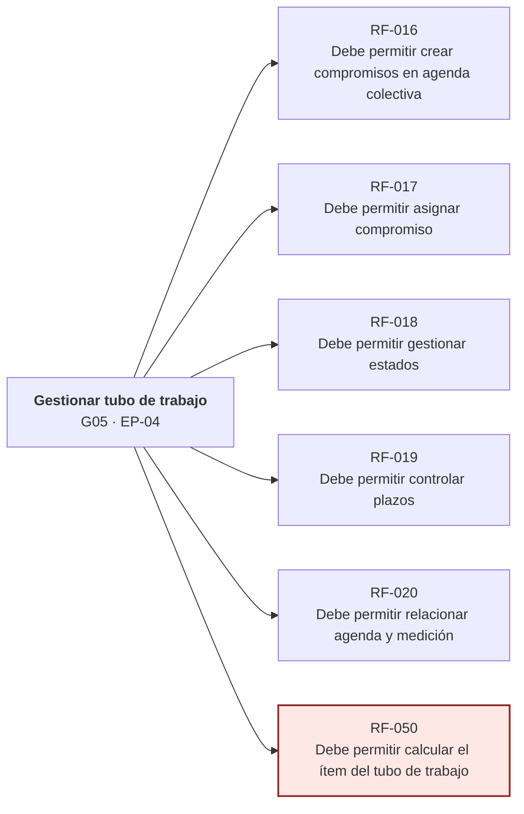

## G06 Gestionar ajustes de puntaje

Épica EP-02: Medición y desempeño.

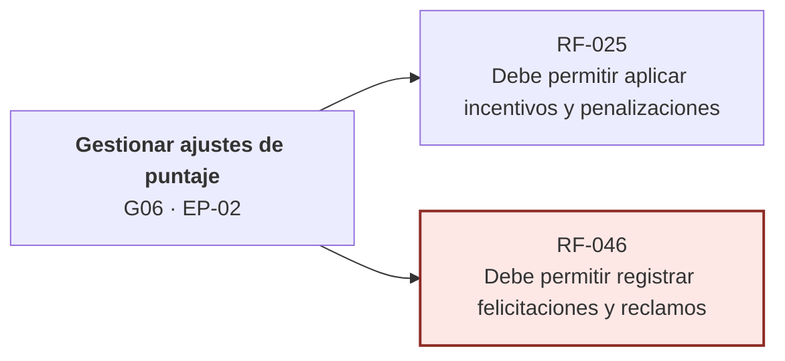

## G07 Gestionar ausencias

Épica EP-02: Medición y desempeño.

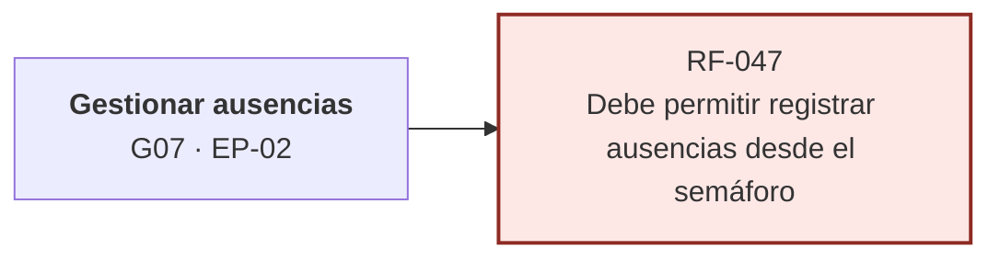

## G08 Gestionar atenciones sociales

Épica EP-01: Registro y gestión de actividades.

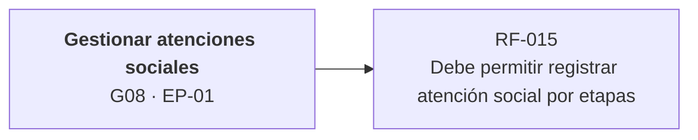

## G09 Gestionar organizaciones comunitarias

Épica EP-01: Registro y gestión de actividades.

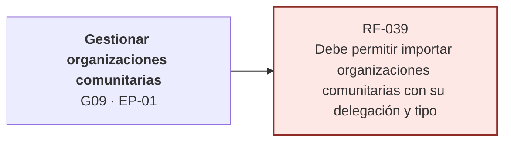

## G10 Gestionar delegaciones

Épica EP-08: Administración, seguridad y trazabilidad.

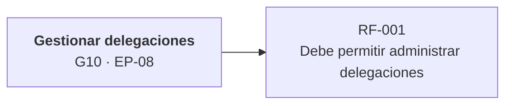

## G11 Gestionar cargos

Épica EP-08: Administración, seguridad y trazabilidad.

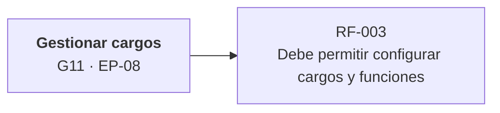

## G13 Gestionar funcionarios y usuarios

Épica EP-08: Administración, seguridad y trazabilidad.

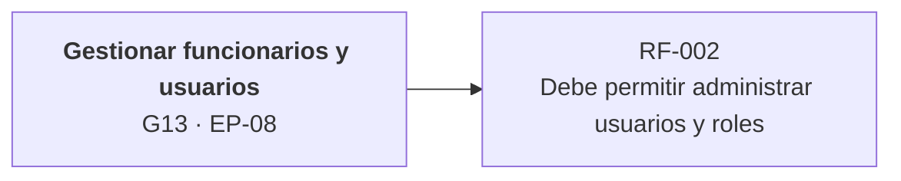

## G14 Gestionar catálogo

Épica EP-08: Administración, seguridad y trazabilidad.

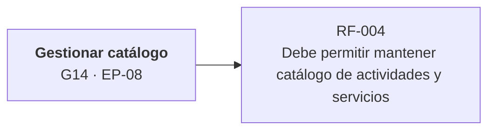

## G15 Gestionar períodos y parámetros

Épica EP-08: Administración, seguridad y trazabilidad.

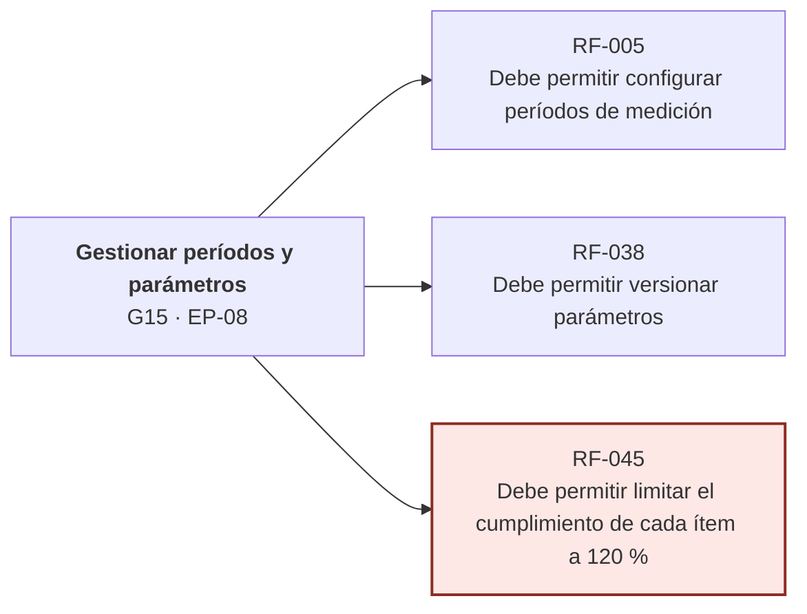

## G16 Gestionar ítems medibles y metas

Épica EP-02: Medición y desempeño.

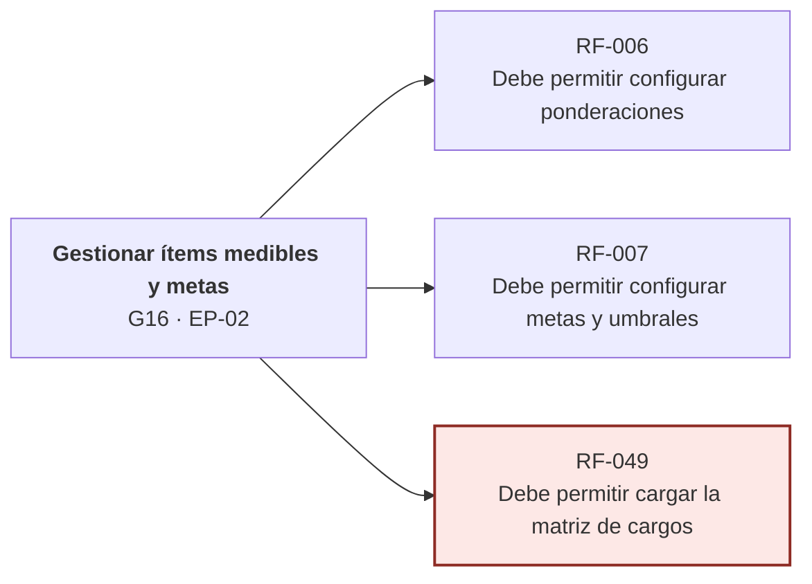

## G17 Consultar resultados

Épica EP-05: Monitoreo y control de gestión.

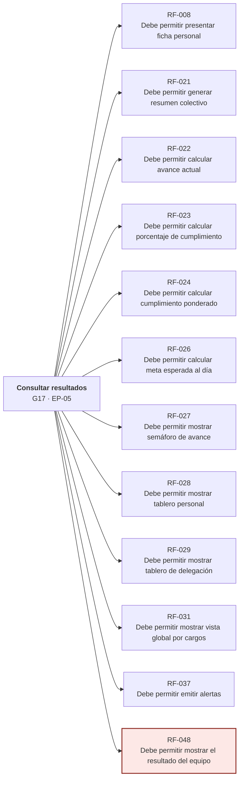

## G18 Generar informes

Épica EP-06: Reportabilidad y toma de decisiones.

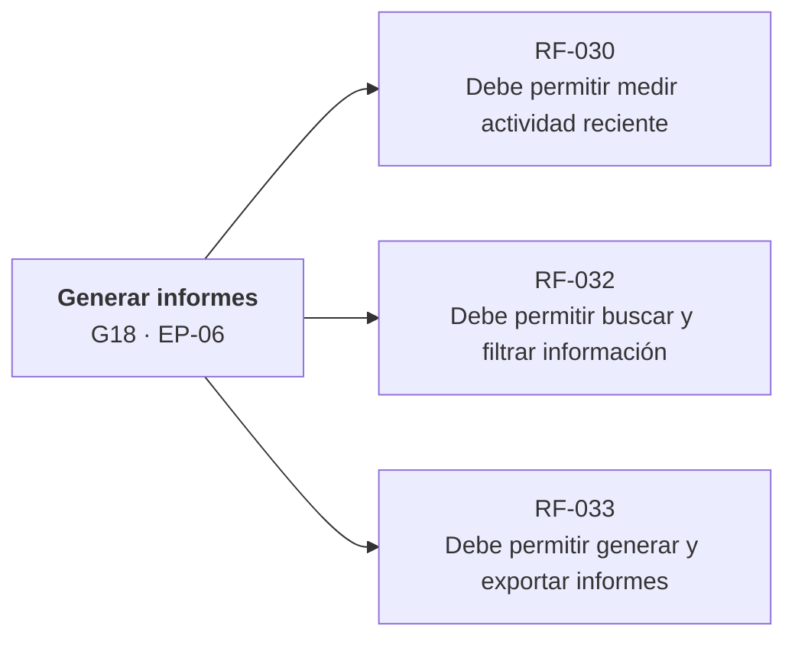

## G19 Consultar auditoría y perfiles

Épica EP-08: Administración, seguridad y trazabilidad.

